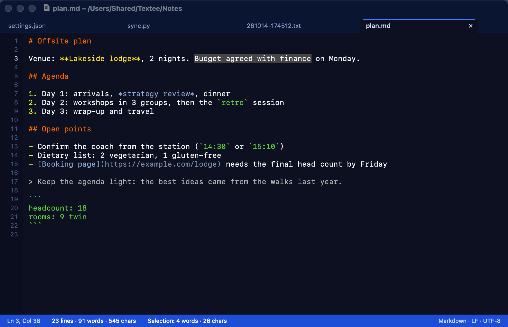
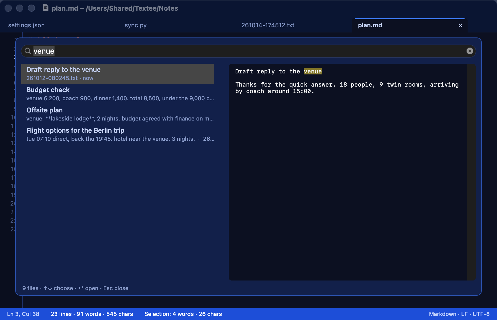
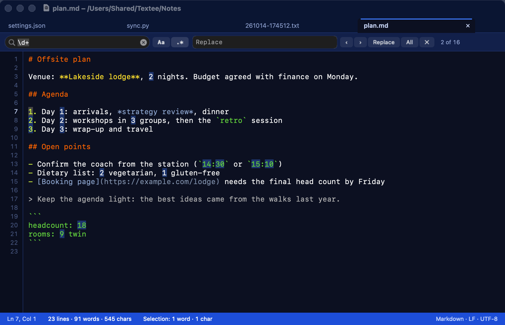
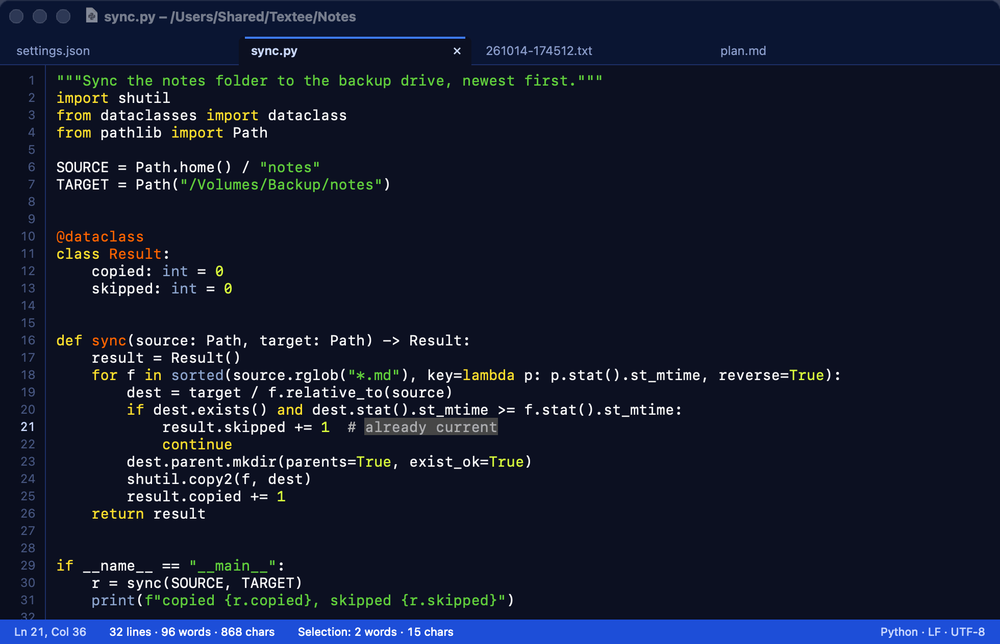

<div align="center">


<h1>Textee</h1>

<p><strong>A fast, light text editor for macOS, built as a clipboard scratchpad.</strong><br>
Tabs, line numbers, live word and character counts, and colours for Markdown, JSON, YAML, Python and shell, in a native app of under 1 MB.</p>

<p>


<a href="LICENSE"></a>
</p>

<p>
<a href="#features">Features</a> ·
<a href="#screenshots">Screenshots</a> ·
<a href="#build-and-install">Build and install</a> ·
<a href="#keys">Keys</a> ·
<a href="#configuration">Configuration</a> ·
<a href="https://notes.nicolasdeville.com/nicai/textee/">The story behind Textee</a>
</p>



</div>

## Why Textee

I built Textee with Claude Code to replace TextMate, and I use it every day. Its main job: a key in Alfred puts the clipboard in a new text file and shows it in a Textee tab, about 8 times a day. So it has to open before I finish the thought, and stay out of the way the rest of the time.


`bench.py` measured these numbers: 5 editors, 7 rounds, every app in a 1920 × 1080 window, from outside the apps. Textee wins 12 of the 16 rows. TextEdit uses less memory with 1 small file, but it doesn't colour Markdown or code.

Textee loads files in 1 MB pieces straight into the text storage, colours only the lines on screen, and recounts only the lines an edit touches. It has no third-party code, no network access and no telemetry.

This is personal software. It does what I need on my Mac, and its keys are mine (see [Keys](#keys)). I don't offer support, and I read issues and pull requests when I have time. Fork it and make it yours.

## Features

### Scratchpad

- **New from clipboard** (⇧⌘N, or `open 'textee://new-from-clipboard'` from Alfred, Raycast or a script): writes the clipboard to `~/txt/YYMMDD-HHMMSS.txt` and opens it in a new tab.
- **New scratch file** (⌘N): an empty timestamped file in `~/txt`, created at once. A scratch file that is still empty when its tab closes is deleted.
- **Auto-save** 1 s after the last keystroke, on a tab switch, when Textee loses focus, and on quit. There is no Save dialog to answer.

### Edit

- **Tabs** in 1 window. Each tab keeps its own editor, so a switch is instant.
- **Live counts** in the status bar: lines, words and characters, for the file and for the selection. The character count follows LinkedIn's rule (UTF-16), and turns green up to 300 (an invitation note) and amber over 3,000 (the post limit).
- **Multiple cursors:** ⌥↩ adds the next match, ⇧⌘A selects every match, ⌥-click adds a cursor.
- **Line commands:** duplicate, delete and move lines, indent and outdent.
- **Plain text, always:** copy and paste carry no formatting. With several cursors and as many clipboard lines, each cursor gets 1 line.
- **Soft wrap, line numbers and zoom**, remembered between launches.

### Find and open

- **Find and replace** (⇧⌘F) with case, regular expressions and `$1` templates. Every match is coloured, with "n of m". **All** replaces in 1 undo step.
- **Quick open** (⌘P): recent files first, then every file in `~/txt`, newest first. Typing searches file names, first lines and content, with a preview of the selected file.

### Colours

The Blackboard theme, for these formats:

| Format     | Coloured                                                       |
| -          | -                                                              |
| Markdown   | Front matter, headings, bold, italic, code, fences, links      |
| JSON       | Keys, strings, numbers, `true`/`false`/`null`, comments        |
| YAML       | Keys, strings, scalars, anchors, comments                      |
| Python     | Keywords, strings, decorators, function and class names        |
| Shell      | Keywords, builtins, strings, variables, comments               |

Markdown inside a `.txt` file stays plain. Files over 5 MB aren't coloured.

### Safe saving

- **Atomic saves** that keep the file's metadata, line endings (LF or CRLF) and BOM.
- **Changes on disk:** a file that changes outside Textee reloads by itself. If you have unsaved edits, a banner asks which version to keep.
- **No accidents:** auto-save never writes an empty buffer over a file with content, and a file that isn't valid UTF-8 opens read-only.

## Screenshots

<table>
<tr>
<td width="50%" valign="top">

<p align="center"><b>Quick open</b><br>⌘P searches names and content as you type.</p>
</td>
<td width="50%" valign="top">

<p align="center"><b>Find and replace</b><br>Regular expressions, every match coloured.</p>
</td>
</tr>
<tr>
<td width="50%" valign="top">

<p align="center"><b>Python</b><br>Colours for code, on the visible lines only.</p>
</td>
<td width="50%" valign="top">

<p align="center"><b>Markdown</b><br>Headings, emphasis, code and links.</p>
</td>
</tr>
</table>

## Build and install

Textee has no download: you build it from source.

Requirements:

- macOS 26 on Apple silicon.
- Xcode 26 and [XcodeGen](https://github.com/yonaskolb/XcodeGen) (`brew install xcodegen`).

To build Textee and copy it to `/Applications`, run:

```bash
./build.sh --install
open /Applications/Textee.app
```

`--install` quits a running Textee first. It saves every tab, but the tabs don't come back: Textee has no session restore.

Without a signing identity, `build.sh` signs the app ad hoc. It runs, but each build looks like a new app to macOS. To sign with your own Developer ID certificate, set the identity before you build:

```bash
export TEXTEE_SIGN_IDENTITY="Developer ID Application: Your Name (TEAMID)"
```

You can also put that line in `.private/signing.env`, which git ignores.

To make Textee the default app for text files, run `duti -s com.nicolasdeville.textee public.plain-text all` (`brew install duti`), then confirm in the macOS prompt.

## Keys

Textee uses the standard menu titles, so your own App Shortcuts in **System Settings > Keyboard** apply. The defaults are my keys, shared with my other editor: note ⌘D for Copy and ⌘F for Paste.

| Key           | Command                          | Key           | Command                       |
| -             | -                                | -             | -                             |
| ⌘N            | New scratch file                 | ⌘D            | Copy                          |
| ⇧⌘N           | New from clipboard               | ⌘F            | Paste                         |
| ⌘O            | Open…                            | ⌥F            | Paste and Match Style         |
| ⌘P / ⌘H       | Quick open / recent files        | ⇧⌘F           | Find…                         |
| ⌘S            | Save now                         | ⌃F            | Hide the find bar             |
| ⌥⌘S           | Save As…                         | ⌘T            | Duplicate line or selection   |
| ⌘W            | Close tab                        | ⌥D            | Delete line                   |
| ⌃⌘W           | Close window (every tab)         | ⌥↑ / ⌥↓       | Move line                     |
| ⌥⌘R           | Reveal in Finder                 | ⌘] / ⌘[       | Indent / outdent              |
| ⇧⌘D           | Copy the path                    | ⌥↩            | Add next match                |
| ⇧⌘] / ⇧⌘[     | Next / previous tab              | ⇧⌘A           | Select all matches            |
| ⌥Z            | Soft wrap                        | ⌘= ⌘- ⌘0      | Zoom                          |

The full list is in `SPEC.md` section 5.

## Configuration

| Path                      | Holds                                                                  |
| -                         | -                                                                      |
| `~/txt/`                  | Scratch files, 1 per clipboard or ⌘N                                   |
| `~/.textee/state.json`    | Recent files, zoom, soft wrap and line numbers. Textee writes it       |
| `~/.textee/settings.json` | Your settings. Textee only reads it, and applies a save at once        |

`settings.json` has 2 keys:

| Key             | Values                    | Default     | Sets                                                    |
| -               | -                         | -           | -                                                       |
| `windowCorners` | `"rounded"` or `"square"` | `"rounded"` | The window corners and shadow                           |
| `cornerRadius`  | 0 (square) to 10          | 4           | The tab highlights, the close button and quick open     |

Square window corners use `_cornerMask`, a private AppKit method. If a later macOS stops calling it, the window stays rounded and nothing else breaks.

## Agent interface

Agents (Claude Code, NicAI CC tasks) drive Textee through the `textee` CLI (`textee.py`; `build.sh --install` links it at `~/.local/bin/textee`). Every command takes `--json` and prints 1 JSON document; errors carry `ok: false`, `error` and `hint`, with exit codes 1 (error), 2 (usage), 3 (refused) and 4 (Textee isn't running). Writes go through `textee://` URLs opened in the background with a request id, and the CLI confirms each one through `~/.textee/live.json`, which the app rewrites on every tab change. A URL with a request id doesn't bring Textee to the front unless the command has `--show`.

```bash
textee describe --json             # every command, with its effect (read or write)
textee status --json               # running, tabs, unsaved, conflicts, newest_scratch
textee tabs --json                 # the open tabs: path, unsaved, conflict, active
textee scratches -n 5 --json       # the 5 newest scratch files in ~/txt
textee new-from-clipboard --json   # the clipboard in a new scratch tab, confirmed, with its path
textee open ~/txt/notes.txt --json # open a file in a tab, in the background
textee save-all --json             # save every unsaved tab (before a quit or an install)
```

## Develop

`SPEC.md` is the specification, with every measurement. `CLAUDE.md` holds the layout, the rules and the AppKit lessons, for you and for Claude Code.

```bash
python3 qa.py           # end-to-end QA, about 1 minute
python3 bench.py        # Textee against 4 editors, about 20 minutes
python3 bench_chart.py  # bench/editors.svg from the results
python3 screenshots.py  # the README screenshots, on made-up files
```

`qa.py` drives the real app in the background through a JSON-scripted harness. It works on copies in `$TMPDIR/textee-qa` and a private pasteboard, so it never touches your files or your clipboard. It and `bench.py` copy their realistic test files from my own `~/txt`: on your Mac, point `REAL_TXT` and the 2 file names at files of your own.

`output/` holds the analyses behind the performance work: an optimisation plan, a look at a rewrite in Rust (rejected), and what it would take to win every benchmark row.

## Licence

MIT. See [LICENSE](LICENSE).
